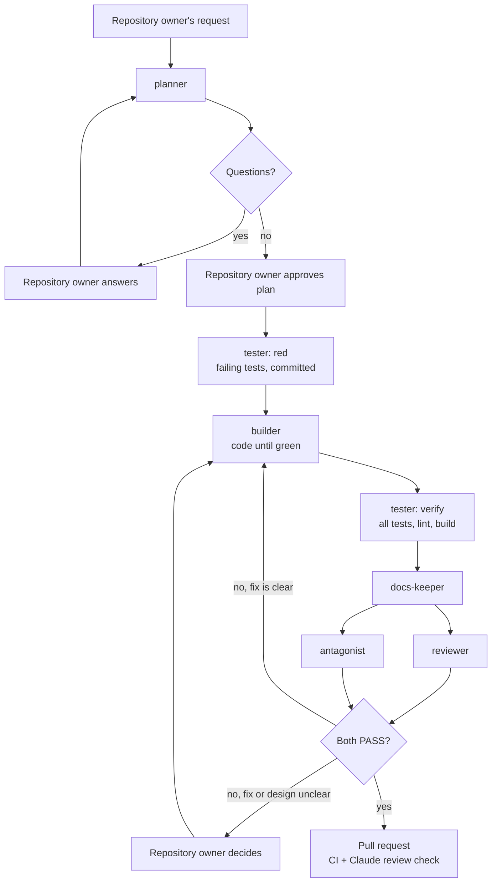

# How Tessera's sub agents work together

Claude Code can hand parts of a job to **sub agents**. A sub agent is a separate Claude with its own instructions, its own tools and, here, its own model. Each Tessera agent is a Markdown file in `.claude/agents/`.

Why split the work? A Claude that wrote the code tends to believe it is right. Giving tests, review and attack to separate agents that did not write the code catches more mistakes. The "builder writes code, tester owns tests" split also stops anyone bending a test to fit the code.

## The agents

| Agent | Job | Model | Can edit |
|---|---|---|---|
| `planner` | Turns a request into a plan with numbered acceptance criteria. Checks it against the specs for contradictions. | Opus | nothing |
| `tester` | Writes failing tests from the plan ("red"), then runs everything and reports ("verify"). Owns all tests. | Sonnet | tests |
| `builder` | Writes the least code that makes the tests pass. | Sonnet | code, never tests |
| `docs-keeper` | Keeps `docs/` (including the roadmap), `CONTEXT.md`, ADRs and the commands tables in step with the code. | Sonnet | Markdown only |
| `reviewer` | Checks the change against the rules in `CLAUDE.md`. Also runs as the "Claude review" GitHub check. | Opus | nothing |
| `antagonist` | Attacks the change: permission bypasses, bad input, two users at once, data loss, design conflicts. Proves each break with a failing test. | Opus | adds proof tests only |

The models are picked for cost. The agents that need careful judgement (planning, review, attack) use Opus. The ones that follow a clear plan (writing tests, writing code, updating docs) use the cheaper, faster Sonnet.

## The order

Sub agents cannot call each other. The main Claude runs them one after another and passes each result on.

## Who decides

The repository owner makes every design choice. Every agent has the same rule: if the plan or the docs do not make the direction clear, it stops and returns a question instead of guessing. The main Claude passes the questions on, at most five at a time, and waits for the answers.

The antagonist may argue against a design, but it cannot settle the argument. A design objection always goes to the repository owner.

## What blocks a pull request

- A serious finding from the `reviewer` (security hole, missing permission check, committed secret, possible data loss, behaviour with no tests).
- A `BLOCK` from the `antagonist`: a proven break that is a security hole, a permission bypass, possible data loss or a crash, or a design objection still waiting for the repository owner.
- Red CI, or a red "Claude review" check.

The antagonist runs only on the developer's machine, not as a GitHub check, to save usage on the Claude plan. It could be added as a check later.
