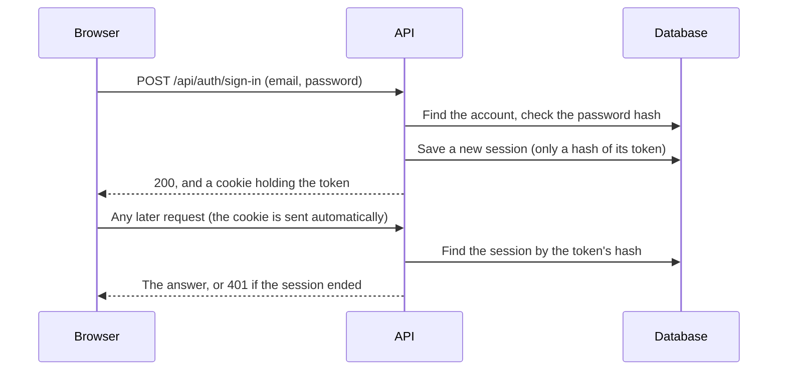

# Web API

The API is what the web app (and anything else) talks to. Every address starts with `/api`, and request and response bodies are JSON. When the API runs locally, it is at http://localhost:3000/api.

Status: accounts, sign-in, project members, projects, boards, cards and threads are built. Endpoints for the card features (subtasks, time, assignees, labels, checklists and the Activity tab) come next.

## How signing in works

- **The cookie** is called `tessera_session`. It is `HttpOnly`, so scripts on a page cannot read it. It is also `SameSite=Lax`, so other websites cannot make the browser send it with their forms. In production it is also `Secure`, so it is only sent over HTTPS.
- **Sessions last 30 days** and move forward while they are used. Signing out ends the session. Changing your password ends all your sessions, but keeps the browser that made the change signed in.
- **Passwords** are at least 10 characters. They are stored only as a scrypt hash: a one-way scramble that is slow to compute on purpose, so a stolen database is very hard to guess passwords from.
- **Guessing is slowed down.** After 5 failed sign-ins for one email in 15 minutes, that email has to wait. The answer is 429 with a `Retry-After` header giving the wait in seconds. A wrong password and an unknown email get the same answer, so nobody can check which emails have accounts by trying to sign in.
- **Sign-up** is open to anyone unless a server admin switches it off. The first account on a new server becomes its server admin, and can always be made.

## Answers you can get

| Code | Meaning |
|---|---|
| 200 / 201 / 204 | Done (201: something was created, 204: done, nothing to send back) |
| 400 | The input is wrong; `message` says what. Unknown fields are refused too |
| 401 | Not signed in, or the session has ended |
| 403 | Signed in, but not allowed (for example, not a project admin) |
| 404 | Not found, or in a project you are not a member of. The two are not told apart, so nobody can find out which projects exist |
| 409 | Clashes with something, for example the email already has an account |
| 429 | Too many failed sign-ins; wait and try again |

## Endpoints

### Accounts and sign-in

| Method and path | Who | What it does |
|---|---|---|
| `POST /api/auth/sign-up` | Anyone (unless sign-up is off) | Body `{ email, displayName, password }`. Creates the account and signs it in |
| `POST /api/auth/sign-in` | Anyone | Body `{ email, password }`. Signs in |
| `POST /api/auth/sign-out` | Anyone | Ends this browser's session |
| `GET /api/auth/me` | Signed in | The signed-in person: `{ id, email, displayName, isServerAdmin }` |
| `POST /api/auth/password` | Signed in | Body `{ currentPassword, newPassword }`. Changes the password |

### Server settings

| Method and path | Who | What it does |
|---|---|---|
| `GET /api/server/settings` | Anyone | `{ signUpOpen }`, so the sign-up page knows whether to show itself |
| `PATCH /api/server/settings` | Server admins | Body `{ signUpOpen }`. Switches sign-up on or off |

### Project members

| Method and path | Who | What it does |
|---|---|---|
| `GET /api/projects/:projectId/members` | Members | Everyone in the project, admins first, then by name |
| `POST /api/projects/:projectId/members` | Project admins | Body `{ email, role? }`. Adds the person who has an account with that email. `role` is `MEMBER` (the default) or `ADMIN` |
| `PATCH /api/projects/:projectId/members/:userId` | Project admins | Body `{ role }`. Changes someone's role |
| `DELETE /api/projects/:projectId/members/:userId` | Project admins, or the person themselves (leaving) | Removes someone. Their card assignments go, and a timer they have running in the project is stopped and its time saved |

A project always keeps at least one admin: making the last admin a member, or removing or leaving as the last admin, gets 409.

Email invitations and "forgot password" need the server to send email, so they come later.

### Projects

| Method and path | Who | What it does |
|---|---|---|
| `GET /api/projects` | Signed in | The projects you are a member of, by name |
| `POST /api/projects` | Signed in | Body `{ name, code, description? }`. Creates a project, with you as its admin. `code` is 2 to 6 letters (e.g. `WEB`) |
| `GET /api/projects/suggest-code?name=...` | Signed in | `{ code }`: the first free code made from a project name, for the "new project" form |
| `GET /api/projects/:projectId` | Members | One project |
| `GET /api/projects/by-code/:code` | Members | A project by its code. Old codes work too |
| `PATCH /api/projects/:projectId` | Project admins | Body `{ code?, timeZone? }`. Changes the code (old card numbers keep working) or the time zone (e.g. `Europe/London`) |

### Boards and columns

| Method and path | Who | What it does |
|---|---|---|
| `GET /api/projects/:projectId/boards` | Members | The project's boards, by name |
| `POST /api/projects/:projectId/boards` | Members | Body `{ name }`. Creates a board with the columns To do, In progress and Done, and its general thread |
| `GET /api/boards/:boardId` | Members | The board with its `columns` in order, each with its `cards` from top to bottom |
| `PATCH /api/columns/:columnId` | Members | Body `{ isDone }`. Marks a column as a done column, or not |

### Cards

| Method and path | Who | What it does |
|---|---|---|
| `POST /api/columns/:columnId/cards` | Members | Body `{ title, description? }`. Creates a card at the bottom of the column, with the next number and its own thread |
| `GET /api/cards/:cardId` | Members | The card, with its full `number` (e.g. `WEB-12.1`) and its `thread` |
| `GET /api/cards/by-number/:number` | Members | A card by its number, e.g. `WEB-12`. Old numbers and codes work too |
| `PATCH /api/cards/:cardId` | Members | Body `{ title?, description? }`. An empty description clears it |
| `POST /api/cards/:cardId/move` | Members | Body `{ columnId, confirmOpenSubtasks? }`. Moves the card to the bottom of another column on its board. Into a done column completes it; out of one reopens it |
| `POST /api/cards/:cardId/complete` | Members | Body `{ confirmOpenSubtasks? }`. Completes the card. Answers `{ card, doneColumnId }`: the done column to offer moving it to, or null |
| `POST /api/cards/:cardId/reopen` | Members | Reopens the card |
| `DELETE /api/cards/:cardId` | The card's creator, or a project admin | Deletes the card; its thread is kept, unlinked. A card with subtasks needs body `{ subtasks: { "<subtask id>": { "action": "delete" or "standalone" } or { "action": "move", "parentId": "..." } } }` with a choice for each direct subtask |

Completing a card, or moving it into a done column, while some of its direct subtasks are open gets 409 with `openSubtasks` (how many). Send the request again with `confirmOpenSubtasks: true` to go ahead. Deleting a card with logged time gets 409 with `loggedMinutes`.

### Threads

| Method and path | Who | What it does |
|---|---|---|
| `GET /api/boards/:boardId/threads` | Members | The board's threads: the general thread first, then the others oldest first |
| `POST /api/boards/:boardId/threads` | Members | Body `{ title }`. Creates a thread that is not linked to a card |
| `PUT /api/threads/:threadId/card` | Members | Body `{ cardId }`. Links the thread to a card on the same board. A card has at most one thread, and the general thread can't be linked (409) |
| `DELETE /api/threads/:threadId/card` | Members | Removes the link. The thread and the card are both kept |
