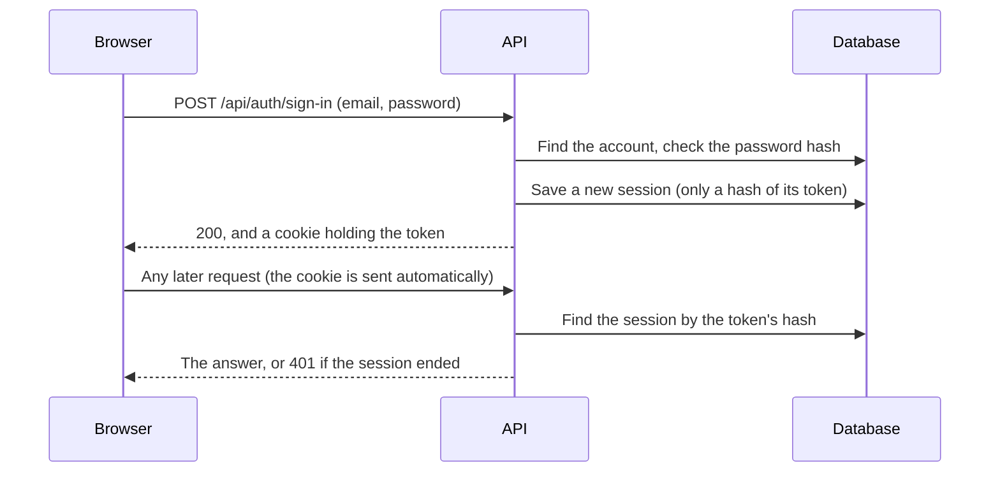

# Web API

The API is what the web app (and anything else) talks to. Every address starts with `/api`, and request and response bodies are JSON. When the API runs locally, it is at http://localhost:3000/api.

Status: every feature the API has so far can be reached through these endpoints. Chat messages and live updates are built (see "Messages" and "Live updates" below). Files on cards are built (see "Files" below); files on messages and the AI features come later.

## How signing in works



- **The cookie** is called `tessera_session`. It is `HttpOnly`, so scripts on a page cannot read it. It is also `SameSite=Lax`, so other websites cannot make the browser send it with their forms. In production it is also `Secure`, so it is only sent over HTTPS.
- **Sessions last 30 days** and move forward while they are used. Signing out ends the session. Changing your password ends all your sessions, but keeps the browser that made the change signed in.
- **Passwords** are at least 10 characters. They are stored only as a scrypt hash: a one-way scramble that is slow to compute on purpose, so a stolen database is very hard to guess passwords from.
- **Guessing is slowed down.** After 5 failed sign-ins for one email in 15 minutes, that email has to wait. The answer is 429 with a `Retry-After` header giving the wait in seconds. A wrong password and an unknown email get the same answer, so nobody can check which emails have accounts by trying to sign in.
- **Sign-up** is open to anyone unless a server admin switches it off. The first account on a new server becomes its server admin, and can always be made.

## Answers you can get

| Code | Meaning |
|---|---|
| 200 / 201 / 204 | Done (201: something was created, 204: done, nothing to send back) |
| 400 | The input is wrong; `message` says what. Unknown fields are refused too, and so is a hidden NUL character (see "Text with a hidden character") |
| 401 | Not signed in, or the session has ended |
| 403 | Signed in, but not allowed (for example, not a project admin) |
| 404 | Not found, or in a project you are not a member of. The two are not told apart, so nobody can find out which projects exist |
| 409 | Clashes with something, for example the email already has an account |
| 413 | A file is bigger than the limit (see "Files") |
| 429 | Too many failed sign-ins; wait and try again |

## Text with a hidden character

A NUL character (code 0, written `\u0000`) is invisible, and PostgreSQL cannot store it, so it is refused everywhere (agreed 2026-11-08, Jon).
- **Every text field** in the shared rules (`packages/shared`) refuses it with the message "This contains a hidden character that can’t be saved". This message comes before any other for the same field (for example before "too short"), and the web forms show it under the field, because they use the same rules. New text fields start from `textWithoutNul()` (in `packages/shared/src/text.ts`), not plain `z.string()`.
- **The whole API** also refuses it with 400 and the same message, wherever it is in the text of the request: a body field name or value, a query value (for example the card search `q`) or a part of the URL (for example `by-code/:code`). This check runs before the other input rules, so a field added later that forgets the shared rule still gets a clear 400 and never a 500. It runs after the sign-in check, so someone not signed in gets 401 "Please sign in" instead, which tells a stranger nothing (agreed 2026-11-08, Jon).
- **A file's contents are not checked.** They are raw bytes, and many files (every PNG, for one) contain NUL bytes. Only the text around a file is: the file's name, and the names of the form fields. The global check runs before the upload form is read and does not see the file's name, so the files code checks the name with the shared `fileNameSchema` and gives the same message (agreed 2026-11-14).
- **Two exceptions.** Sign-in `password` and change-password `currentPassword` may hold one, as before, because they are only compared with the stored hash and never saved as text. A new password (sign-up `password`, change-password `newPassword`) refuses it.
- Other control characters, and tabs, new lines and emoji, are still accepted.

## Live updates

The API tells open browser tabs that something changed, so screens stay current without waiting for a reload. It does this with **signals, then reload**: a signal says only *what* changed, never the data itself. The browser then loads that piece again through the normal endpoints above, so every reload goes through the same permission checks as any other request. Nothing private travels over the live connection. The reasons are in [ADR 0002](adr/0002-live-updates-signals-then-reload.md).

### Connecting

- The live connection uses Socket.IO at the path `/socket.io`, on the same address as the API (so there is still no CORS, see [ADR 0001](adr/0001-web-app-and-api-on-one-origin.md)). It is not under `/api`.
- The session cookie is checked when the connection is made (the handshake). A connection without a valid session is refused with the error "Please sign in".
- Signing out ends that session's live connections straight away. So does changing the password: it ends the person's other sessions, and the live connections of every session it ended are closed, including the browser that made the change, which then reconnects with its new session.
- Sessions that expire are swept every `LIVE_SESSION_SWEEP_MS` milliseconds (default 30000; a value from 1000 to 86400000 is used, anything else gives 30000; read once when the API starts), and the live connections of an expired session are closed, without waiting for it to ask for anything. This is the only setting for live updates, an optional environment variable of the API.
- A `join-board` from a session that has ended or expired gets `{ ok: false }` and its connection is closed.
- The MVP runs on one server. Running several servers would need a shared message layer (Redis) so a signal reaches tabs connected to another server; that is left for later.

### Rooms

A signal goes to a **board's room**. A tab is in one board's room at a time, because it shows one board at a time. If a tab asks for several boards in quick succession, the last board asked wins: an earlier join that is answered later gets `{ ok: false }` and leaves the tab out of that room. Someone removed from the project while a join is being answered is left out too.

| Message from the browser | What it does | Answer |
|---|---|---|
| `join-board` with `{ boardId }` | Joins that board's room, and leaves the one it was in. Allowed only for a member of the board's project | `{ ok: true }`, or `{ ok: false }` for a board that does not exist, a project you are not a member of, or a body that is not a board id. The server never says which |
| `leave-board` | Leaves the current board's room | `{ ok: true }` |

A connection that is not in a room receives nothing. Rooms are forgotten when a connection drops, so the browser joins again once it is back. Someone removed from a project (or who leaves it) leaves that project's boards' rooms at once, without reconnecting, and gets no more signals.

### Signals

The server sends the event `signal` to everyone in the board's room:

```json
{ "type": "card", "boardId": "…", "cardId": "…", "by": "Ab12…" }
```

| Field | Meaning |
|---|---|
| `type` | `card`, `board`, `chats` or `message` (see below) |
| `boardId` | The board whose room gets the signal. Always present |
| `cardId` | Only with `card`: the card that changed |
| `chatId`, `messageId` | Only with `message`: the message that changed, and its chat |
| `by` | The id of the connection that made the change (see `X-Live-Connection`), or `null` when the save did not say. A signal never holds text, names or other card content |

| Type | Means | What the browser reloads |
|---|---|---|
| `card` | A card changed | The board; and the card panel, if it shows that card |
| `board` | A card came, went or moved on the board | The board |
| `chats` | The board's list of chats changed | The sidebar's chat list |
| `message` | A message was sent, edited or deleted | That chat's messages. A message older than the latest page is loaded with `GET /api/messages/:messageId` and replaced in place |

**Who sends which signal.** A signal is sent only after a save worked. A refused or failed save (400, 403, 404, 409) sends none, and neither does sending the same message again (the answer 200 above).

- **Cards.** Creating, editing (title, description, estimate, priority, due date and so on), moving, completing, reopening, deleting; changing assignees, the owner or labels on a card; changing a checklist or one of its items; changing a subtask or a time entry; starting or stopping a timer. Each sends a `card` signal for the card. Attaching a file to a card or removing one sends `card` for that card. Deleting a card with `moveFilesTo` also sends `card` for the card that took the files. Creating, moving and deleting a card also send `board`. When a deleted card's subtasks are moved under a new parent, that parent card gets a `card` signal and its board a `board` signal too.
- **Cards above it.** A card's progress, time and totals show on the cards above it (its parents), so each of those parents gets a `card` signal too. A change that touches cards on two boards (a subtask on another board, a parent's totals, moving a card with its subtasks under another parent) sends signals to both boards' rooms.
- **Chats.** Creating a chat sends `chats`. Linking a chat to a card, or unlinking it, sends `chats`, and `card` for each card it was or is on. Creating or deleting a card, or making a subtask from a checklist item, also sends `chats`, because a card comes with its own chat.
- **Messages.** Sending, editing and deleting a message send `message` with `chatId` and `messageId`.
- **Columns.** Changing a column's done flag (`PATCH /api/columns/:columnId`) sends `board`.
- **Not live.** Project-wide changes (labels, members, project settings, the project list) send no signals. Screens show them when you come back to the browser tab ([web-app.md](web-app.md) section 6).

### `X-Live-Connection`

Every save the web app sends carries the header `X-Live-Connection` with the id of that tab's live connection. The server copies it into the `by` of the signals the save causes, so the tab that made the change can ignore its own signal (its screen is already up to date). The header is optional, but it is checked: it must name a live connection of the same signed-in session as the save. Otherwise (missing, made up, or another person's connection id) `by` is `null` and everyone, the sender included, reloads. No other value ever reaches a signal.

## Endpoints

### Accounts and sign-in

| Method and path | Who | What it does |
|---|---|---|
| `POST /api/auth/sign-up` | Anyone (unless sign-up is off) | Body `{ email, displayName, password }`. Creates the account and signs it in |
| `POST /api/auth/sign-in` | Anyone | Body `{ email, password }`. Signs in |
| `POST /api/auth/sign-out` | Anyone | Ends this browser's session |
| `GET /api/auth/me` | Signed in | The signed-in person: `{ id, email, displayName, isServerAdmin }` |
| `POST /api/auth/password` | Signed in | Body `{ currentPassword, newPassword }`. Changes the password |

### Server settings

| Method and path | Who | What it does |
|---|---|---|
| `GET /api/server/settings` | Anyone | `{ signUpOpen, fileSizeLimitBytes }`: whether the sign-up page shows itself, and the largest file in bytes (from the `FILE_SIZE_LIMIT_MB` environment variable, default 100 MB), so the web app can refuse a file that is too big before sending it |
| `PATCH /api/server/settings` | Server admins | Body `{ signUpOpen }`. Switches sign-up on or off. Answers like `GET`. The file size limit cannot be changed here |

### Project members

| Method and path | Who | What it does |
|---|---|---|
| `GET /api/projects/:projectId/members` | Members | Everyone in the project, admins first, then by name |
| `POST /api/projects/:projectId/members` | Project admins | Body `{ email, role? }`. Adds the person who has an account with that email. `role` is `MEMBER` (the default) or `ADMIN` |
| `PATCH /api/projects/:projectId/members/:userId` | Project admins | Body `{ role }`. Changes someone's role |
| `DELETE /api/projects/:projectId/members/:userId` | Project admins, or the person themselves (leaving) | Removes someone. Their card assignments go, and a timer they have running in the project is stopped and its time saved |

A project always keeps at least one admin: making the last admin a member, or removing or leaving as the last admin, gets 409.

Email invitations and "forgot password" need the server to send email, so they come later.

### Projects

| Method and path | Who | What it does |
|---|---|---|
| `GET /api/projects` | Signed in | The projects you are a member of, by name |
| `POST /api/projects` | Signed in | Body `{ name, code, description? }`. Creates a project, with you as its admin. `code` is 2 to 6 letters (e.g. `WEB`). `ADMIN` is not allowed, because `/admin` is the server settings screen |
| `GET /api/projects/suggest-code?name=...` | Signed in | `{ code }`: the first free code made from a project name, for the "new project" form |
| `GET /api/projects/:projectId` | Members | One project |
| `GET /api/projects/by-code/:code` | Members | A project by its code. Old codes work too |
| `PATCH /api/projects/:projectId` | Project admins | Body `{ code?, timeZone?, relationColours? }`. Changes the code (old card numbers keep working), the time zone (e.g. `Europe/London`), or some of the relationship colours: `relationColours` has any of `selected`, `parent`, `subtask`, `deeperSubtask` and `sibling`, each one of the 10 label colours or `DARK`. Projects answer with all five in `relationColours` |

### Boards and columns

| Method and path | Who | What it does |
|---|---|---|
| `GET /api/projects/:projectId/boards` | Members | The project's boards, by name |
| `POST /api/projects/:projectId/boards` | Members | Body `{ name }`. Creates a board with the columns To do, In progress and Done, and its general chat |
| `GET /api/boards/:boardId` | Members | The board with its `columns` in order, each with its `cards` from top to bottom. Each card also has its `number` (`WEB-12`), `labels` (by name), `assignees` (owner first), `checklistProgress` `{ done, total }`, `subtaskProgress` `{ complete, total }` (direct subtasks only) and `chatId`, so the board needs no request per card |
| `PATCH /api/columns/:columnId` | Members | Body `{ isDone }`. Marks a column as a done column, or not |

### Cards

| Method and path | Who | What it does |
|---|---|---|
| `POST /api/columns/:columnId/cards` | Members | Body `{ title, description?, chatId? }`. Creates a card at the bottom of the column, with the next number and its own chat. With `chatId`, the card takes that chat instead of a new one ("Create a card for this chat?"). The chat must be on the same board and not linked to a card, and can't be the general chat (409) |
| `GET /api/cards/:cardId` | Members | The card, with its full `number` (e.g. `WEB-12.1`) and its `chat` |
| `GET /api/projects/:projectId/cards?q=...&limit=20` | Members | Finds cards on any board of the project, for example to pick a new parent. `q` (1 to 100 characters) is a card number (`WEB-12`, just `12`, an old number or an old project code) or words from a title, in any letter case. Answers `{ cards }`, at most `limit` (1 to 50, default 20): the card with that number and then its subtasks, then cards whose title contains `q` (the newest ones, when more match than fit), each group in number order, each with `id`, `number`, `title`, `boardId`, `boardName`, `isComplete` and `depth` (0 for a top-level card) |
| `GET /api/cards/by-number/:number` | Members | A card by its number, e.g. `WEB-12`. Old numbers and codes work too |
| `PATCH /api/cards/:cardId` | Members | Body with any of `title`, `description` (empty clears it), `priority` (`NONE`, `LOW`, `MEDIUM`, `HIGH` or `URGENT`), `due` and `estimateMinutes` (null clears it). `due` is `{ "date": "2026-11-02" }`, `{ "at": "2026-11-02T17:00:00+01:00" }` (the offset is required) or null. Everything is checked before anything changes. Answers with the card |
| `POST /api/cards/:cardId/move` | Members | Body `{ columnId, position?, confirmOpenSubtasks? }`. Moves the card to another column on its board, or to another place in its own column. `position` 0 is the top; past the end, or left out, is the bottom. Into a done column completes it; out of one reopens it. Moving between columns is recorded in the card's history; reordering within a column is not |
| `POST /api/cards/:cardId/complete` | Members | Body `{ confirmOpenSubtasks? }`. Completes the card. Answers `{ card, doneColumnId }`: the done column to offer moving it to, or null |
| `POST /api/cards/:cardId/reopen` | Members | Reopens the card |
| `DELETE /api/cards/:cardId` | The card's creator, or a project admin | Deletes the card; its chat is kept, unlinked. A card with subtasks needs body `{ subtasks: { "<subtask id>": { "action": "delete" or "standalone" } or { "action": "move", "parentId": "..." } } }` with a choice for each direct subtask. The card's files are deleted with it (their stored objects too, once the card is gone). With the query `?moveFilesTo=<cardId>` they move to that card instead, in the same transaction as the delete, and that card's Activity gets a `FILE_MOVED` line for each. The card must be in the same project and not be one of the cards being deleted: else 404 "Card not found" or 400 "Pick a card that is not being deleted", and nothing is deleted. The files of subtasks chosen for deletion are handled the same way |

Completing a card, or moving it into a done column, while some of its direct subtasks are open gets 409 with `openSubtasks` (how many). Send the request again with `confirmOpenSubtasks: true` to go ahead. Deleting a card with logged time gets 409 with `loggedMinutes`.

### Chats

| Method and path | Who | What it does |
|---|---|---|
| `GET /api/boards/:boardId/chats` | Members | The board's chats: the general chat first, then the others oldest first |
| `POST /api/boards/:boardId/chats` | Members | Body `{ title }`. Creates a chat that is not linked to a card |
| `PUT /api/chats/:chatId/card` | Members | Body `{ cardId }`. Links the chat to a card on the same board. A card has at most one chat, and the general chat can't be linked (409) |
| `DELETE /api/chats/:chatId/card` | Members | Removes the link. The chat and the card are both kept |

### Messages

A chat's messages. The text of a message is Markdown. Only project members may use these endpoints: for anyone else, a chat gives 404 "Chat not found" and a message gives 404 "Message not found", so nobody can tell whether it exists. Every project member can read and post in every chat of the project; private chats come after the MVP (agreed 2026-11-09).

| Method and path | Who | What it does |
|---|---|---|
| `GET /api/messages/:messageId` | Members | One message as it is now, in the same shape as in the list above. It lets a screen refresh an older message it kept after someone edited or deleted it (see "Live updates"). Non-members and unknown ids get 404 "Message not found"; an id that is not a UUID gets 400 |
| `GET /api/chats/:chatId/messages?before=<messageId>` | Members | `{ messages, hasOlder }`: the newest 50 messages, oldest first. With `before`, the 50 sent just before that message, in the same order. They are ordered by time and then id, so messages sent at the same moment are never repeated or missed between pages. A `before` that is not a message id gets 400; one that is not a message of this chat gets 404 "Message not found" |
| `POST /api/chats/:chatId/messages` | Members | Body `{ body, id? }`. Sends a message, written by you. Answers 201 with the message. `id` is optional: a UUID the browser makes for the message, so that sending it again ("Try again") never saves it twice. If a message with that `id` already exists in this chat, written by you, the answer is 200 with that message and nothing new is saved. If the `id` belongs to another person's message or to a message in another chat, the answer is 409 "This message id is already used" (agreed 2026-11-10) |
| `PATCH /api/messages/:messageId` | The author only | Body `{ body }`. Edits the message, sets `editedAt` and answers with it. Anyone else, a project admin included, gets 403 "Only the author can edit a message". A deleted message gets 409 "This message was deleted". No history of earlier texts is kept (agreed 2026-11-09) |
| `DELETE /api/messages/:messageId` | The author, or a project admin | Marks the message deleted: sets `deletedAt` and `deletedBy`, keeps the text, and answers with the message. Another member gets 403 "Only the author or a project admin can delete a message". A message that is already deleted gets 409 "This message was deleted". A delete is final (agreed 2026-11-09) |

Each message has `id`, `chatId`, `body`, `createdAt`, `editedAt` (null until edited), `deletedAt` (null until deleted), `author` and `deletedBy` (each `{ id, displayName }`, or null when nobody is recorded, for example once that account is deleted). A deleted message is still listed, with its text, because the web app shows it crossed out (agreed 2026-11-09).

The body has its spaces at both ends dropped. It cannot be blank, and it is at most 10,000 characters (more gives 400 "Use at most 10000 characters"). It may nest lists and quotes (counted together) at most 10 levels deep, counted the way Markdown reads the text: quote marks count with or without spaces after them (`>>>>>>>>>>>x` is 11 levels), lists nested inside quotes by indenting count, anything inside a code block (fences are read the way CommonMark reads them, also inside quotes and list items) and divider lines such as `- - -` or `***` do not, and when it is unclear the rule refuses (agreed 2026-11-10); 10 is accepted, and deeper gives 400 "Use at most 10 levels of lists and quotes" (agreed 2026-11-10; the wording is the current proposal, the owner has not objected). The characters `<`, `>` and `&` are kept as typed in the stored text, except for the escapes Markdown needs for the text to read back as typed. The text is escaped as it is written: a line that starts with something Markdown would turn into formatting (`#`, `>`, `-`, `+`, `1.` or `1)`) gets a backslash, and an `&` that looks like the start of an entity (such as `&lt;`) is escaped, so a typed `&lt;` is stored as `&amp;lt;`. Plain `<`, `>` and `&` stay as typed, and code is never touched (agreed 2026-11-10). It follows the shared rules in `packages/shared` (`messageBodySchema`), so the web app's message box gives the same answer, and a hidden NUL character is refused like everywhere else (see "Text with a hidden character").

### Subtasks

| Method and path | Who | What it does |
|---|---|---|
| `GET /api/cards/:cardId/subtasks` | Members | `{ subtasks, progress }`: the direct subtasks in number order, and `{ complete, total }` for them. Each subtask also has its `number` (`WEB-12.1`), `columnName` and `boardName` (its own column and board, which may be another board of the project) and `subtaskProgress` `{ complete, total }` (its own direct subtasks only), so the list needs no request per subtask |
| `POST /api/cards/:cardId/subtasks` | Members | Body `{ columnId, title, description? }`. A subtask in any column of the project, numbered under the card (`WEB-12.1`). At most 5 levels deep (409) |
| `PUT /api/cards/:cardId/parent` | Members | Body `{ parentId }`, or null for the top level. Moves the card with its own subtasks. They get new numbers, and the old ones keep working |
| `GET /api/cards/:cardId/relatives` | Members | `{ parents, subtasks, siblings }`, on any board of the project, for outlining a selected card's relatives. Parents go nearest first; subtasks are every level below, in number order, each with `level` (1 is a direct subtask); siblings share the card's parent. Each has `id`, `number`, `title`, `boardId`, `boardName` and `isComplete` |
| `GET /api/cards/:cardId/due-warnings` | Members | `{ dueAfterParent, subtasksDueAfter }`, for the "due after its parent" warnings |

### Assignees

Each of these answers with the card's assignees afterwards, owner first.

| Method and path | Who | What it does |
|---|---|---|
| `GET /api/cards/:cardId/assignees` | Members | The assignees, each with `user` and `isOwner` |
| `PUT /api/cards/:cardId/assignees/:userId` | Members | Assigns a project member. The first person assigned becomes the owner |
| `DELETE /api/cards/:cardId/assignees/:userId` | Members | Unassigns. Removing the owner hands ownership to the person assigned longest |
| `PUT /api/cards/:cardId/owner` | Members | Body `{ userId }`, who must already be assigned |

### Labels

| Method and path | Who | What it does |
|---|---|---|
| `GET /api/projects/:projectId/labels` | Members | The project's labels, by name |
| `POST /api/projects/:projectId/labels` | Members | Body `{ name, colour }`. `colour` is one of `GREY`, `RED`, `ORANGE`, `YELLOW`, `GREEN`, `TEAL`, `BLUE`, `INDIGO`, `PURPLE` or `PINK` |
| `PATCH /api/labels/:labelId` | Project admins | Body `{ name?, colour? }` |
| `DELETE /api/labels/:labelId` | Project admins | Deletes the label and takes it off every card |
| `GET /api/cards/:cardId/labels` | Members | The card's labels |
| `PUT /api/cards/:cardId/labels/:labelId` | Members | Puts a label on the card |
| `DELETE /api/cards/:cardId/labels/:labelId` | Members | Takes it off |

### Time

| Method and path | Who | What it does |
|---|---|---|
| `GET /api/cards/:cardId/time-entries` | Members | Everyone's time on the card, latest day first, each with `user` |
| `POST /api/cards/:cardId/time-entries` | Members | Body `{ minutes, workDate, note? }`. 1 minute to 24 hours, on a day that has started in the project's time zone (400 otherwise, naming the zone) |
| `PATCH /api/time-entries/:entryId` | The person who logged it (for 24 hours), or a project admin | Body `{ minutes?, workDate?, note? }` (`note: null` removes it). A new `workDate` must be a day that has started in the project's time zone; one left out or sent back unchanged is not checked again. Also clears the "needs review" flag |
| `DELETE /api/time-entries/:entryId` | Same as above | Deletes the entry |
| `GET /api/cards/:cardId/time-totals` | Members | Estimate and time spent, rolled up from the card's subtasks |
| `POST /api/cards/:cardId/timer` | Members | Body `{ stopRunning? }`. Starts your timer on the card, dated the day it starts in the project's time zone. Sending `timeZone` gets 400. If yours is running on another card, you get 409 with `runningCardId`; send `stopRunning: true` to stop that one (its time is saved) and start this one |
| `GET /api/timer` | Signed in | `{ timer }`: your running timer, or null |
| `DELETE /api/timer` | Signed in | Stops your timer. `{ entry }` is the time saved, or null if it ran under half a minute. 404 if none is running |

### Files

Files on cards. Every byte goes through the API, which checks first that the person is signed in and a member of the project. The storage behind it (SeaweedFS, through the S3 API) is private and never reachable by the browser ([ADR 0003](adr/0003-files-in-seaweedfs-through-the-s3-api.md)). A non-member, an unknown id, or a card or file of another project all get 404, so nobody can tell what exists. Files on messages come in a later pull request.

| Method and path | Who | What it does |
|---|---|---|
| `POST /api/cards/:cardId/files` | Members | One file as a multipart form, in the field `file`. Stores it and answers 201 with the file. 404 "Card not found" for a non-member, an unknown card or a card deleted meanwhile |
| `GET /api/cards/:cardId/files` | Members | `{ files }`, newest first (ties in a fixed order) |
| `GET /api/files/:fileId/download` | Members | The exact bytes, always as a download |
| `GET /api/files/:fileId/preview` | Members | The image, inline. Only for a PNG, JPEG, GIF or WebP; any other file gets 404 "File not found" |
| `DELETE /api/files/:fileId` | The person who added it, or a project admin | Removes the file, from storage too. Answers 204 |

**The file** (`CardFile` in `@tessera/shared`): `id`, `name`, `size` (bytes), `isImage`, `uploader` (`{ id, displayName }`, or null once that account is deleted), `createdAt`, and `messageId` and `chatId` (both null for a card's own file; they are for files on messages, later).

**Rules:**
- **Streamed.** The upload is passed on to the storage piece by piece, never held whole in memory. The bytes are counted as they pass.
- **Size.** Over the limit (`fileSizeLimitBytes`, see "Server settings") the answer is 413 "Files can be at most 100 MB" (the number follows the setting), whether or not the browser announced the size, and nothing is left in storage or the database. A file exactly at the limit is accepted.
- **Form.** No file, a file in another field, or any other form field gets 400 "Attach one file". Two files get 400 "Attach one file at a time".
- **Name.** The browser's file name with any folder part removed (`C:\Users\jon\plan.pdf` and `../plan.pdf` both become `plan.pdf`) and spaces at both ends dropped. Letters from any language and emoji are kept as typed. A NUL character gets 400 "This contains a hidden character that can’t be saved", an empty name 400 "This can’t be empty", and more than 255 characters 400 "Use at most 255 characters" (the shared `fileNameSchema`).
- **Image or not** is decided by the API from the file's first bytes, whatever name or type the browser sent. An SVG, an HTML file renamed `x.png`, or text sent as `image/png` is not an image (`isImage: false`). The type kept in the database is the detected one ([data-model.md](data-model.md)).
- **Downloads** send `Content-Disposition: attachment` with the name (an ASCII fallback plus the full name as `filename*=UTF-8''...`, so names in any language survive), `Content-Type: application/octet-stream`, `X-Content-Type-Options: nosniff` and `Content-Length`. A name cannot break or add to a header. A malformed id gets 400, an unknown one 404 "File not found".
- **Previews** send the detected image type, `X-Content-Type-Options: nosniff` and `Content-Security-Policy: default-src 'none'; sandbox`, so nothing inside a file can run from the app's address.
- **Removing.** Another member gets 403 "Only the person who added a file or a project admin can remove it", and the file stays. A project admin can remove a file whose uploader's account was deleted. The row and the card's Activity line `FILE_REMOVED` are saved together, then the stored object is deleted. If deleting the object fails, the failure is logged and the answer is still 204: nobody can reach the leftover object, because only rows lead to objects.
- **Attaching** saves the stored object first, then the row and the `FILE_ADDED` Activity line together. If the row cannot be saved, the object is deleted again.
- **Live.** Attaching and removing send a `card` signal (see "Live updates"); a refused request sends none.
- **Settings.** The storage is set by the environment variables `S3_ENDPOINT`, `S3_REGION`, `S3_BUCKET`, `S3_ACCESS_KEY_ID`, `S3_SECRET_ACCESS_KEY` and `S3_FORCE_PATH_STYLE`, and the size limit by `FILE_SIZE_LIMIT_MB` (see `apps/api/.env.example`). They are read once when the API starts; a missing or wrong one stops it with a message naming it (never its value). The API makes its bucket at start if it is missing.

### Checklists

| Method and path | Who | What it does |
|---|---|---|
| `GET /api/cards/:cardId/checklists` | Members | The card's checklists in order, each with its `items` and `progress` (`{ done, total }`) |
| `POST /api/cards/:cardId/checklists` | Members | Body `{ name }`. An empty name gives 400 "This can’t be empty"; a name over 100 characters gives "Use at most 100 characters". `suggestNewCard` in the answer is true once the card has more than 10 |
| `PATCH /api/checklists/:checklistId` | Members | Body `{ name?, position? }`. Renames and/or moves it (0 is first). The name follows the same limit as when creating (empty: "This can’t be empty"; over 100: "Use at most 100 characters") |
| `DELETE /api/checklists/:checklistId` | Members | Deletes it with its items |
| `POST /api/checklists/:checklistId/items` | Members | Body `{ text }`. Adds an item at the bottom; at most 100, then 409 "A checklist holds up to 100 items". An empty text gives 400 "This can’t be empty"; text over 500 characters gives "Use at most 500 characters" |
| `PATCH /api/checklist-items/:itemId` | Members | Body `{ text?, isDone?, position? }`. Edits, ticks and/or moves the item. The text follows the same limit as when adding (empty: "This can’t be empty"; over 500: "Use at most 500 characters") |
| `DELETE /api/checklist-items/:itemId` | Members | Deletes the item |
| `POST /api/checklist-items/:itemId/subtask` | Members | Replaces the item with an unassigned subtask of the card, titled with its text |

Names and item text have the spaces around them dropped. An empty or spaces-only one, a name over 100 characters or an item over 500 gets 400. These are the shared rules in `packages/shared`, so the web app's forms give the same answer.

### Activity

| Method and path | Who | What it does |
|---|---|---|
| `GET /api/cards/:cardId/activity?limit=50&before=...` | Members | The card's history, newest first: `{ items, nextBefore }`. Each line has `kind`, `details`, `actor` and `createdAt`. Pass `nextBefore` as `before` to get the next, older page; it is null on the last page. The type of `details` (`ActivityDetails` and its helper types) comes from `@tessera/shared`, so the API and the web app share one definition (agreed 2026-11-08). Files add the kinds `FILE_ADDED` and `FILE_REMOVED` (`{ fileId, name, size }`) and `FILE_MOVED` (the same, plus `from`, the deleted card's `numberPath` and `title`) |
