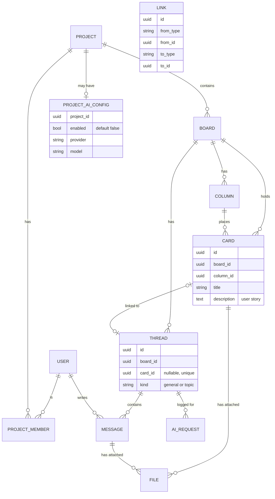

# Data model v0.2 (draft)

Status: draft for review. Covers the MVP only. Task tables, Gantt charts, milestones and dependencies are not modelled yet.

## Diagram

`LINK` connects cards, chats (`THREAD` in the diagram) and messages to each other. Each link has a type from a list the project admin keeps. Links get their own design round with chat. It is drawn on its own because it points at more than one kind of thing.

## Entities

| Entity | Purpose | Key fields |
|---|---|---|
| User | A person with an account | id, display_name, email (stored in lower case), password_hash (scrypt), is_server_admin |
| Session | A signed-in browser | id, token_hash (the browser's token is never stored), user_id, last_used_at, expires_at |
| FailedSignIn | A failed sign-in, so repeated guesses can be slowed down | email, created_at |
| ServerSettings | Settings for the whole server (always one row) | sign_up_open |
| Project | Top-level container | id, name, description |
| ProjectMember | Who belongs to a project and their role | project_id, user_id, role (admin or member) |
| Board | Kanban board and chat space | id, project_id, name |
| Column | A kanban column | id, board_id, name, position |
| Card | Task or user story | id, board_id, column_id, title, description, position (more fields planned: see below) |
| Thread | A chat conversation | id, board_id, card_id (optional), kind |
| Message | One chat message | id, thread_id, author_id, body, created_at, deleted_at |
| File | Uploaded file metadata | id, project_id, uploader_id, filename, mime_type, size, storage_key, card_id or message_id |
| Link | Connection between cards, chats and messages, with a type the person picks from a list the project admin keeps (agreed 2026-10-31; not built yet, designed with chat) | from_type, from_id, to_type, to_id, link type |
| ProjectAiConfig | Whether AI is on for a project, and which provider it uses | project_id, enabled, enabled_by, enabled_at, provider, model, encrypted_api_key |
| AiRequest | Audit log of AI use | id, thread_id, user_id, kind, provider, created_at |

## Rules the database must enforce

1. A card has at most one thread: `Thread.card_id` is unique and optional.
2. Each board has exactly one thread with kind `general`, and it has no card.
3. `ProjectAiConfig.enabled` defaults to false. No AI request is allowed for a project where it is false, and only a member with the admin role can change it.
4. A file is attached to exactly one thing: a card or a message.
5. Deleting a message marks it deleted (`deleted_at`); it is not erased, so history stays consistent.
6. All IDs are UUIDs, so they do not reveal how many records exist.
7. A card's column, and a thread's card, are on the same board as the card or thread (composite foreign keys).
8. A column that still has cards cannot be deleted. A card that still has a thread cannot be deleted directly; deleting a card through the API unlinks its thread first, so the chat is kept.
9. Deleting a project deletes its boards; deleting a board deletes its columns, cards and threads.

Rules 1, 2 (the "at most one general thread" part) and 7 to 9 are in place and tested in `apps/api/src/boards/board-rules.db-spec.ts`. "Exactly one" general thread is the job of `BoardsService.createBoard`, which creates it with the board.

Accounts and sessions are tested in `apps/api/src/auth/sign-in-rules.db-spec.ts`: email addresses are stored in lower case, a session token hash is never stored twice, an account's sessions end when it is deleted, and there is exactly one row of server settings. How sign-in works is described in [api.md](api.md).

## Behaviour decided so far

- A new board starts with the columns To do, In progress and Done, and its general thread.
- A new card always gets its own thread, created with it. A thread made on its own can be linked to a card later, and a link can be removed.
- New cards, and cards moved to another column, go to the bottom of that column.

## Decisions and trade-offs

- **"Chat", not "channel".** A card's chat and a board's chat are the same kind of thing. In the database and code a chat is still called `Thread` until the rename pull request after the board view (agreed 2026-10-31). After that, "thread" means only the replies to one message (CONTEXT.md).
- **Generic Link table.** One table is simple, but the database cannot check that the target exists. The alternative is separate tables for each kind of link, which is stricter but longer. Revisit when links are built.
- **AI settings.** AI is switched on per project by an admin, so the setting lives in `ProjectAiConfig`. Once on, every thread in the project can be sent to the AI provider. A way to exclude individual threads may be added later.
- **API keys.** Stored encrypted and never returned by the API.

## Card features (planned)

[card-features.md](card-features.md) describes what cards will do. This section lists the database changes it needs. They will be added one pull request at a time, each with its own database tests.

**Built so far:** project codes and card numbers, subtasks, completion and done columns, old card numbers, estimates, time entries and timers, assignees, labels, priority, due dates, card creators, checklists and card history. The tables below are marked ✓ where built. Their rules are tested in `apps/api/src/projects/numbering-rules.db-spec.ts`, `apps/api/src/cards/subtask-rules.db-spec.ts`, `apps/api/src/time/time-rules.db-spec.ts`, `apps/api/src/cards/card-fields-rules.db-spec.ts` `apps/api/src/checklists/checklist-rules.db-spec.ts` and `apps/api/src/activity/activity-rules.db-spec.ts`.

### Changes to existing tables

| Table | New fields | Why |
|---|---|---|
| Project | ✓ code (2 to 6 capitals, unique), ✓ next_card_number, ✓ time_zone (set by admins; used for due-date days), highlight_colours | Card numbers like `WEB-12`; relationship colours are a project setting only admins change |
| Column | ✓ is_done | Moving a card into a done column ticks it complete |
| Card | ✓ project_id, ✓ parent_id (nullable), ✓ number_path (e.g. `12.1.2`), ✓ next_subtask_number, ✓ depth, ✓ is_complete, ✓ completed_at, ✓ priority, ✓ due_at, ✓ due_has_time, ✓ estimate_minutes, ✓ created_by_id (replaces the single assignee_id) | Subtasks, card numbers, completion, priority, due dates, estimates, delete permission |

### New tables

| Entity | Purpose | Key fields |
|---|---|---|
| ✓ CardAssignee | Who is assigned to a card | card_id, project_id, user_id, is_owner, assigned_at |
| ✓ Checklist | A named checklist on a card | id, card_id, project_id, name, position |
| ✓ ChecklistItem | One tick-box item in a checklist | id, checklist_id, text, is_done, position |
| ✓ Label | A project-wide label | id, project_id, name, colour (one of a fixed set of 10) |
| ✓ CardLabel | Which labels a card has | card_id, label_id, project_id |
| ✓ TimeEntry | Time someone spent on a card | id, project_id, card_id, user_id, work_date, minutes, note, started_at, ended_at, needs_review |
| ✓ RunningTimer | A timer that is running now | user_id (primary key, so one per person), project_id, card_id, started_at, work_date (the day it started, in the person's time zone) |
| ✓ CardActivity | The card's history (Activity tab) | id, card_id, project_id, actor_id, kind, details (names copied in when written), created_at, sequence (the order lines were written) |
| ✓ CardNumberAlias | Old card numbers that still lead to the card | project_id, number_path, card_id |
| ✓ ProjectCode | Every code a project has had, current and old, so old codes still work. The code is the primary key, so no two projects ever share one | code, project_id |

### Rules the database will enforce

- ✓ A parent and its subtask are in the same project (`card.project_id` with composite foreign keys), but may be on different boards.
- ✓ Subtasks go at most 5 levels deep (`depth` between 0 and 4, check constraint).
- ✓ A card number is unique within its project. Old numbers never clash with live ones, because new numbers always come from counters that only go up.
- ✓ A card with subtasks cannot be deleted directly; the API asks what to do with each subtask first.
- ✓ A completion time is recorded exactly when a card is complete.
- ✓ A card has at most one owner among its assignees (partial unique index), and assignees must be project members (foreign key to the membership, so leaving a project removes the person's assignments).
- ✓ A label name is unique within its project (the API also refuses names that differ only in letter case), is not blank, and a label only goes on cards in its own project.
- ✓ A due date without a time is stored as midnight UTC of that day.
- ✓ A checklist is in its card's project, its name is 1 to 100 characters, and an item's text is 1 to 500 characters.
- ✓ A time entry is 1 minute to 24 hours, and a timer entry has a start and a later end.
- ✓ A time entry is in its card's project, and a card with logged time cannot be deleted.
- ✓ An estimate is not negative.
- ✓ Card history is append-only: a trigger refuses any update or delete, except deleting it with its card or project and clearing the person when their account is deleted. History stays in its card's project.

### Decisions still to make while building

- ✓ **Rollups.** Estimate and time totals are worked out with a recursive query when read, not stored. Stored totals can drift out of date, so they will only be added if reading becomes slow.
- ✓ **Number paths.** `number_path` is stored, and the subtasks' paths are rewritten when a card moves to another parent. The old paths are saved as aliases at the same time.

## Not in this version

Message replies inside a thread, reactions, file versions, notifications, task dependencies, milestones.
