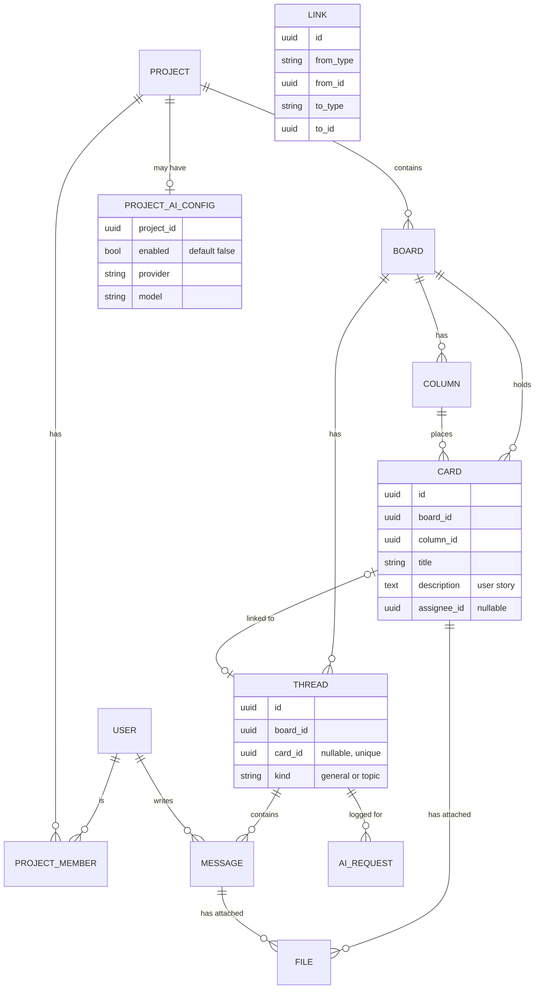

# Data model v0.2 (draft)

Status: draft for review. Covers the MVP only. Task tables, Gantt charts, milestones and dependencies are not modelled yet.

## Diagram

`LINK` connects cards and threads to each other (card to card, card to thread, thread to thread). It is drawn on its own because it points at more than one kind of thing.

## Entities

| Entity | Purpose | Key fields |
|---|---|---|
| User | A person with an account | id, display_name, email, password_hash |
| Project | Top-level container | id, name, description |
| ProjectMember | Who belongs to a project and their role | project_id, user_id, role (admin or member) |
| Board | Kanban board and chat space | id, project_id, name |
| Column | A kanban column | id, board_id, name, position |
| Card | Task or user story | id, board_id, column_id, title, description, position |
| Thread | A chat conversation | id, board_id, card_id (optional), kind |
| Message | One chat message | id, thread_id, author_id, body, created_at, deleted_at |
| File | Uploaded file metadata | id, project_id, uploader_id, filename, mime_type, size, storage_key, card_id or message_id |
| Link | Relationship between cards and threads | from_type, from_id, to_type, to_id |
| ProjectAiConfig | Whether AI is on for a project, and which provider it uses | project_id, enabled, enabled_by, enabled_at, provider, model, encrypted_api_key |
| AiRequest | Audit log of AI use | id, thread_id, user_id, kind, provider, created_at |

## Rules the database must enforce

1. A card has at most one thread: `Thread.card_id` is unique and optional.
2. Each board has exactly one thread with kind `general`, and it has no card.
3. `ProjectAiConfig.enabled` defaults to false. No AI request is allowed for a project where it is false, and only a member with the admin role can change it.
4. A file is attached to exactly one thing: a card or a message.
5. Deleting a message marks it deleted (`deleted_at`); it is not erased, so history stays consistent.
6. All IDs are UUIDs, so they do not reveal how many records exist.

## Decisions and trade-offs

- **"Thread" only.** The earlier word "channel" is dropped, because a card's chat and a board's chat are the same kind of thing.
- **Generic Link table.** One table is simple, but the database cannot check that the target exists. The alternative is separate tables for each kind of link, which is stricter but longer. Revisit when links are built.
- **AI settings.** AI is switched on per project by an admin, so the setting lives in `ProjectAiConfig`. Once on, every thread in the project can be sent to the AI provider. A way to exclude individual threads may be added later.
- **API keys.** Stored encrypted and never returned by the API.

## Not in this version

Message replies inside a thread, reactions, file versions, notifications, task dependencies, milestones.
