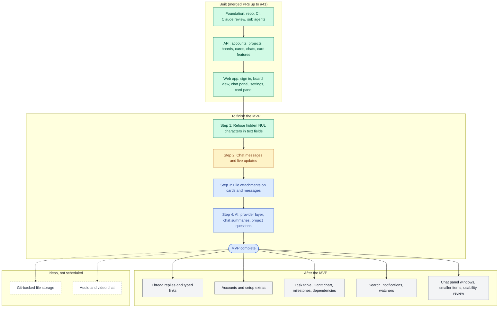

# Roadmap

Status: agreed with the repository owner on 2026-11-08. The `docs-keeper` agent updates it whenever a pull request finishes or starts a step (agreed 2026-11-08).

This page shows what is built, what is left for the first version (the MVP), and what comes after. The MVP scope itself is defined in [PROJECT.md](../PROJECT.md) ("Version 1 (MVP) scope"); this page tracks progress against it and suggests an order. Words follow [CONTEXT.md](../CONTEXT.md).

## Where we are

The API and the web app cover accounts, projects, boards, cards with every card feature planned for the first version except attachments, and chats with messages (sending, editing, deleting; in the chat messages pull request, still open). Chats do not update live yet, and files and AI are not started.

## The flowchart

Green is done, amber is next, blue is the rest of the MVP, grey is after the MVP, and dashed boxes are ideas.

## MVP progress

| MVP item (from PROJECT.md) | Status |
|---|---|
| 1. Users and sign-in; a project with members | Done |
| 2. Boards with kanban cards, a general chat, and multiple chats | Boards, cards, chats and chat messages are done (messages built in the chat messages pull request, agreed 2026-11-09). Live updates are still to build, in their own pull request next |
| 3. Card and chat linking, the "Create a card?" prompt and retroactive creation | Done |
| 4. File upload attached to a card or message | Not started (needs MinIO) |
| 5. AI provider layer with chat summaries and project questions, off by default | Not started |

## Suggested order to finish the MVP

Each step gets its own plan, approved before building, as usual.

1. **Refuse hidden NUL characters** in every text field. A small clean-up left from web PR 7. Done in #43.
2. **Chat messages and live updates**, in two pull requests (agreed 2026-11-09). Messages come before attachments and AI because both depend on them.
   - **Chat messages:** built in the first pull request (still open). Sending, editing, deleting, Markdown, card-number and website links. They refresh with the existing 30-second reload.
   - **Live updates (WebSockets):** next, in their own pull request with its own plan. They cover messages, board cards, the open card panel and the sidebar's chat list, and remove the 30-second reload ([web-app.md](web-app.md) section 6).
3. **File attachments** on a card or on a message, stored in MinIO, 100 MB per file by default ([card-features.md](card-features.md)).
4. **AI**: the provider layer (Claude first), turning AI on per project by a project admin, summarising a chat and answering questions about a project.

## Done so far

| Area | What was built | Pull requests |
|---|---|---|
| Foundation | README, CI (Shared, API, Web and Browser jobs, started in the initial scaffold), Claude review check, sub agents, dependency security fixes | #1, #19, #21, #23, #24, #33, #34 |
| Database | PostgreSQL and Prisma; users, projects, members, boards, columns, cards, chats | #2, #3 |
| Card features (API) | Card numbers, subtasks, completion, estimates, time tracking, assignees, labels, priority, due dates, checklists, Activity history | #4 to #10, #15 |
| Endpoints | Accounts, sign-in and members; endpoints for everything above | #11, #12, #14 |
| Web app design | Web app spec, glossary, first ADR, shared validation package | #16, #17 |
| API for the web app | Card order, board card summaries, new card from a chat, chat rename, relationship colours, card search, time in the project's time zone, subtask list details | #18, #25, #26, #28, #30, #35, #36, #37 |
| Web app | Sign in and projects, board view and dockable chat panel, project settings and admin screen, card panel, checklists, subtasks, time and timer, Activity tab | #22, #27, #29, #31, #32, #38 to #41 |
| Input safety | Hidden NUL characters refused in every text field and anywhere in a request ([api.md](api.md) "Text with a hidden character") | #43 |
| Chat messages | Messages table, API to send, list, edit and delete messages, and the chat panel's message list and message box (the pull request number is added when it is opened) | this pull request |

## After the MVP

Not yet ordered. Each gets its own plan when its turn comes.

- **Chat extras**: thread replies opening in their own sub-window, reactions, and typed links between chats, cards and messages (types kept by a project admin, see [CONTEXT.md](../CONTEXT.md) "Link"). Card-to-card links ("blocks", "relates to") from [card-features.md](card-features.md) may share the same list of types.
- **Accounts and setup**: email invitations and "forgot password" (needs email sending), renaming a project and changing its description, remembering panel layout in the account instead of the browser, and a ready-to-run self-host package (Docker Compose for the whole app).
- **Chat panel**: a floating window and a separate browser window.
- **Planning views**: task table, Gantt chart (needs start dates on cards), milestones and task dependencies.
- **Finding and following**: search across chats, cards and files; notifications and watchers.
- **Smaller items**: story points as an alternative to hours, moving checklist items between checklists, file versions, and a way to exclude single chats from AI (open question in PROJECT.md).
- **Quality**: a functionality and usability review of the running web app.

## Ideas, not scheduled

- Git-backed file storage for chats, aimed at distance teams.
- Audio and video chat attached to chats.
